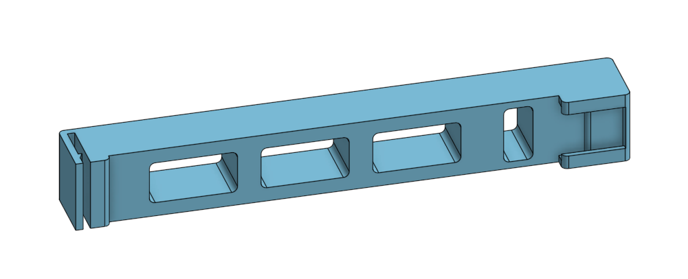
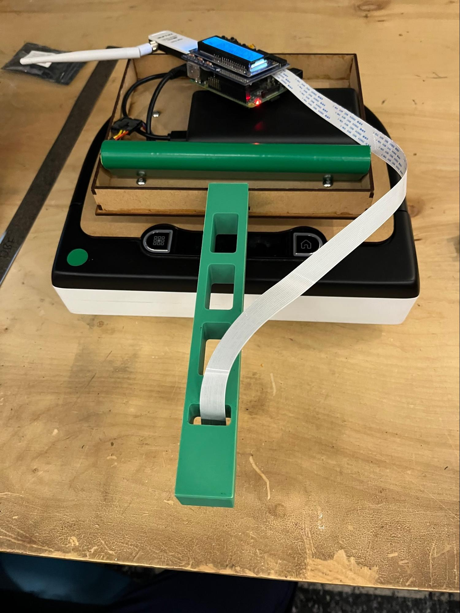
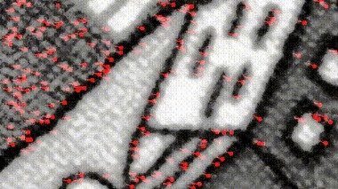
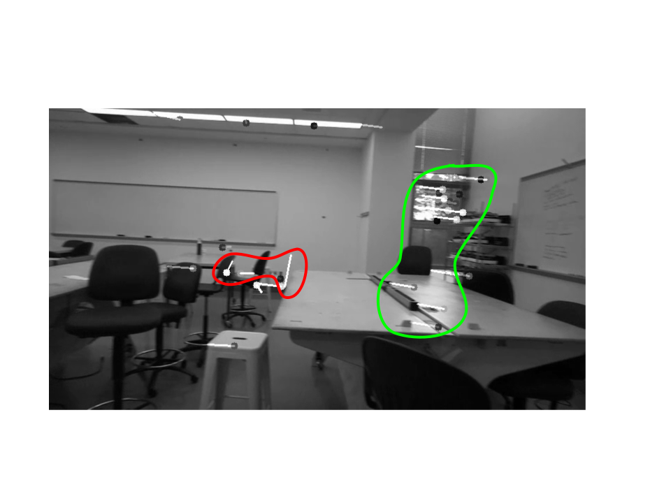

# Neato Pose Estimation Using Optical Flow Analysis 

### By Pippin Fleete, Liam Brennan, Dionysus Lively

[Link to the write up in google docs.](https://docs.google.com/document/d/1JapfCOhbbcn60oc0wVcxAEDKgE_OFWcPe2zSGbyLJos/edit?tab=t.0)

## GenAI Statement

AI was used as a secondary step in debugging and to generate or modify multiple documentation strings. For debugging code was pasted into an LLM and we resolved suggested issues manually after considering potential problems that GenAI pointed out. Additionally GenAI was occasionally used to complete singular lines of in line code (no more than 10 times) if the suggested line was congruent with the intended effect. No GenAI modified or added to any part of this write up except for generating the table of contents.

## Objective
Our goal was to continuously localize a Neato robot vacuum by analyzing images of the floor directly in front of the Neato with OpenCV’s optical flow model. Using custom camera housing and connectors we first built the appropriate infrastructure to collect the necessary images. In addition to adapting the optical flow model for our project we implemented a pixel-length conversion algorithm to give meaning to the vectors output by the optical flow model. Finally, we differentiated between rotational and longitudinal movement by specifying mean movement vector angle ranges and updated the location and heading of our Neato continuously.

## Methodology
We used an optical flow program included in the OpenCV library that uses the Lucas-kanade. Optical flow works by finding keypoints in an image. Keypoints can be areas of high contrast or corners in an image. The optical flow then finds these keypoints in a new image that is a different capture of the same thing in the world.  By tracking how these keypoints move frame to frame we can make a vector field that represents how the projection of the world the camera sees moves relative to the camera, as our camera is looking at a flat surface it is parallel to we can easily convert the vector field from units of pixels to units of distance using empirical measurements of distance of the camera to the floor and the field of view. After determining in units of distance we find the average–affected as it is by outliers–direction and heading of the vector field which represents how the camera moves relative to the ground. From the angles of the average vector we determine if the Neato is turning or moving longitudinally. If longitudinal movement is identified the Neato’s position is simply updated by the average vector in the appropriate direction; if rotation is determined, the position remains the same for that specific timestep, and the Neato’s heading is modified by the angle between the middle of the Neato and the end of the average vector relative to the base-link axis that intercepts the camera and the middle of the Neato as well.

To perform optical flow, we chose to mount the camera to protrude roughly 9 inches from the front of the Neato. By constraining the position and orientation of the camera relative to the Neato with our custom attachment, we ensure that the field of view of the camera is constant and parallel with any flat surface that the Neato traversed. This reduced the need for camera calibration and image processing through preventing noticeable image distortion. 

**Figure 1:** Neato camera attachment where the camera slots into the right-hand attachment and faces downward. The left-hand attachment connects to a ⅛ inch wide board with a slot to hook onto.

**Figure 2:** The fully integrated Neato apparatus. 

In order to determine the true length of a vector in the world compared to its length pixels we found the fraction of the camera's field of view each pixel took up. By multiplying the length of the vector pixels by this we can find the fraction of the FOV the vector takes up. Using trigonometry and the measured height of the camera relative to the ground and its measured view breadth in degrees we found the length in meters that each pixel represents, giving units and scale to the corresponding vectors generated from our optical flow model.

  
**Figure 3:** A gif showing the camera's view as the neato drives on a carpet. The red vectors represent the movement of keypoints in optical flow.

  
**Figure 4:** In red are some vectors that the OpenCV calculated incorrectly, in green are correct vectors for the movement of the camera. 

## Limitations
We learned that reading libraries can be difficult even if they are frequently used; specifically, the OpenCV optical flow code had very little documentation. We also learned about some of the broader uses and implementations of optical flow and that it is often computed onboard a dedicated optical flow sensor to allow systems that use the sensors to save processing power as the computation is far more efficient on dedicated devices. Lastly, we learned how to integrate open source software and develop strong high level understanding of how models work and how their outputs and input interface with each other, which was integral to our successful integration and testing. We also learned how to collaboratively explore and evaluate different design options and also the drawbacks that can stem from overplanning if over conceptualization results in stagnation.

## Next Steps
Further developments of this project include implementing an algorithm to return the Neato return to its starting point using its estimated change in position and heading. This would have been an effective way to test the accuracy of our localization as we would have a measurable test for how precise our pose estimation code works. Additionally, the localization could incorporate wheel odometry and lidar data to further enhance the localization and even recreate a simple model of the surrounding world. Lastly, the pixel to meter conversion function may be turned to more accurately model Neato movement as currently the direction and consistency of angular and longitudinal velocity is correct, however the magnitude can be scaled better.

## Challenges
A challenge we faced while working on this project was that the keypoint detection function we used was imperfect and we struggled to tune the parameters to give us consistent keypoints, we tried to fix this by raising the exposure of our image but very high exposure led to artifacts in our image that only generated more false key points. This leads to most frames having at least a few wayward optical flow vectors which we need to filter out to prevent from messing up our data. When occasionally the keypoint finder failed to recognize any keypoints we were met with difficult to debug errors due to their rarity, but after figuring out their cause they were easy to fix by checking if any key points were generated for a given frame.

## Learnings
We learned that reading libraries can be difficult even if they are frequently used; specifically, the OpenCV optical flow code had very little documentation. We also learned about some of the broader uses and implementations of optical flow and that it is often computed onboard a dedicated optical flow sensor to allow systems that use the sensors to save processing power as the computation is far more efficient on dedicated devices.

## Team Contributions
Dionysus Lively created the housing for the camera, wrote the update heading function and collaborated with Liam on the update position function. He also debugged the final algorithm with Liam and formatted the code and generated docstrings. Lastly, he included all needed files in the repo and finalized the write up for submission. Liam implemented the optical flow model itself to output vectors for the pose update step. He also integrated his code with Pippen's and provided skeleton code for the pose update step. He wrote about his design decisions in the write up and captured  two pictures showcasing optical flow as well. Finally, Pippen implemented the pixel calibration function to determine the real world length of the vectors output by the optical flow model, and contributed to the corresponding methodology parts of the write up as well as the learnings and challenges sections.

## Running the Optical Flow Localizer

1. Follow the steps linked below to ensure Ros2 (and therefore Rviz2) and relevant Neato packages are installed on your environment [computational setup](https://comprobo26.github.io/How%20to/setup_your_environment).  
   1. NOTE: this setup assumes that you are running our localizer on Ubuntu and if you have already installed the linux OS then you may skip steps 0-2. It is also assumed that you use a Neato to run this code.  
2. Clone the following repo into your Ros2 directory to ensure that you have the required neato packages for connecting to and running your Neato.  
   1. NOTE: this   
3. Clone the repo into your Ros2 /src directory that contains this READ.me and necessary Ros2 nodes.  
4. Download the necessary python packages into the environment that you will be running the optical flow localizer in. The python specific dependencies are found in requirements.txt  
5. Build and source all packages in your ros2 directory in the terminal.

   `colcon build \--symlink-install` 

   `source install/setup.bash`

6. Type and run `rviz2` in the terminal to display ros2 topics. Subscribe to the /pose_estimate topic to see eventually the output of the optical flow model.  
7. Connect to your Neato using the following line of code.  
   1. ros2 launch neato\_node2 bringup.py host:=IP\_OF\_ROBOT  
8. Launch tele operation to move the Neato by running the following command.  
   `ros2 run teleop\_twist\_keyboard teleop\_twist\_keyboard\`  
9. Run the optical flow localizer using the following command.  
   `ros2 run machine\_vision\_team\_2 optical\_flow\_estimate\`  
10. Return to the teleop terminal and reduce the angular and vertical speeds for better performance. Move the Neato only forwards or backward, or rotate the Neato and watch the pose estimate update in real time in rviz2. You make look at the quantitative pose estimates using   
   `ros2 topic echo pose\_estimate\`

## Visualizing Our Final Run With a Bag File 

1. Run steps 1-6 as well as the actual model (step 9\)  in the previous section to ensure you have the correct setup and are currently running the flow model.  
2. Instead of running the model on your own robot, you may visualize the results from our final test run by downloading the .mcap file linked to google drive [here](https://drive.google.com/file/d/1u0911rQ-UTrV9mxasNFTTnpCQmnXuK6R/view?usp=sharing) and run the following line to publish the topics received from the Neato and the camera.  
   `ros2 bag play /path/to/Op_Flow_Final_Bag_0.mcap` 

###  Ros Bag Description and Video

The ros bag included is one where the real Neato moves forward approximately 1.5 meters, turns counterclockwise about 45 degrees, moves forward about .25 meters, rotates counter-clockwise roughly 170 degrees and then moves backwards an additional 1.5 meters or so before the ros bag stops recording. A video demonstration of this movement can be accessed [here](https://drive.google.com/file/d/1LS5Z9XjyafnIvbbPAXq-uDBQDoMj9REG/view?usp=drive_link). The visualization should look like [this video](https://drive.google.com/file/d/1KehJ0n0cjTatNrmhE9I_NFTSiMYy4YAE/view?usp=sharing) of the optical flow model running in real time.

## Full External URLS

Nicely  Formatted Google Docs READ.me: [https\://docs.google.com/document/d/1JapfCOhbbcn60oc0wVcxAEDKgE\_OFWcPe2zSGbyLJos/edit?tab=t.0](https://docs.google.com/document/d/1JapfCOhbbcn60oc0wVcxAEDKgE_OFWcPe2zSGbyLJos/edit?tab=t.0)

Computational Setup: [https\://comprobo26.github.io/How%20to/setup\_your\_environment](https://comprobo26.github.io/How%20to/setup_your_environment)

Final Bag File: [https\://drive.google.com/file/d/1u0911rQ-UTrV9mxasNFTTnpCQmnXuK6R/view?usp=sharing](https://drive.google.com/file/d/1u0911rQ-UTrV9mxasNFTTnpCQmnXuK6R/view?usp=sharing)

Neato Movement Video: [https\://drive.google.com/file/d/1LS5Z9XjyafnIvbbPAXq-uDBQDoMj9REG/view?usp=drive\_link](https://drive.google.com/file/d/1LS5Z9XjyafnIvbbPAXq-uDBQDoMj9REG/view?usp=drive_link)

Rviz Live Pose Update: [https\://drive.google.com/file/d/1KehJ0n0cjTatNrmhE9I\_NFTSiMYy4YAE/view?usp=sharing](https://drive.google.com/file/d/1KehJ0n0cjTatNrmhE9I_NFTSiMYy4YAE/view?usp=sharing)